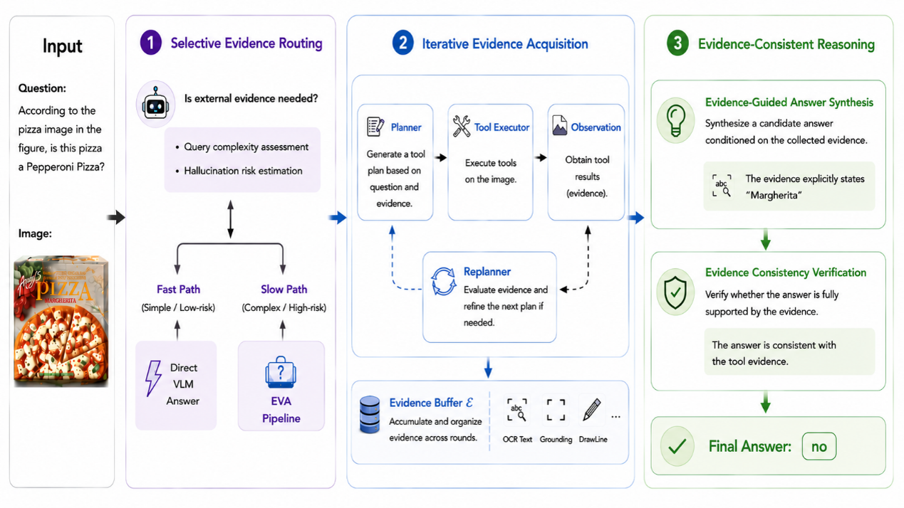

<div align="center">

# EVA
### Evidence-seeking Visual Agent for Hallucination-Resistant Multimodal Reasoning

**[Ting Lei](mailto:ting_lei@pku.edu.cn), [Yu Chen](mailto:yu_chen@stu.pku.edu.cn), [Yang Liu](mailto:yangliu@pku.edu.cn)**

Wangxuan Institute of Computer Technology, Peking University

**NeurIPS 2026**

[](#installation)
[](#introduction)
[](#introduction)
[](LICENSE)

[Introduction](#introduction) | [Installation](#installation) | [Quick Start](#quick-start) | [Evaluation](#evaluation) | [Citation](#citation)

</div>

## Introduction

**EVA frames multimodal reasoning as an active evidence-seeking process.** It
identifies what remains unresolved, acquires targeted visual evidence, and checks
whether that evidence supports the answer. A selective fast/slow pathway directs
external computation toward the observations that matter for the question.

<p align="center">
  
</p>

- **Selective Evidence Routing.** Adaptively choose between direct reasoning and external evidence acquisition.
- **Iterative Evidence Acquisition.** Let new observations guide the next plan, building a shared evidence buffer across rounds.
- **Evidence-Consistent Reasoning.** Synthesize answers from accumulated evidence and verify their support before responding.

This repository provides **Qwen2.5-VL-7B-Instruct** and **InternVL3-14B** implementations with five
tools: **OCR, GroundingDINO, DrawLine, DrawShape, and GetBarInfo**.

## Installation

Create the evaluation environment on a Linux machine with NVIDIA CUDA:

```bash
conda create -n eva python=3.10 -y
conda activate eva
pip install torch==2.7.1 torchvision==0.22.1
pip install -e .
```

Install the requirements for your backbone:

```bash
# Qwen2.5-VL
pip install flash-attn==2.8.3 --no-build-isolation
# InternVL3 (BF16 / SDPA)
pip install -r requirements/internvl.txt
```

Prepare the tool environments following [Tool Setup](docs/tools.md).

## Quick Start

### 1. Launch the Tools

```bash
conda activate eva-tools
python scripts/start_tools.py --gpu 0 --chart-gpu 1 \
  --ocr-python /path/to/ocr-env/bin/python \
  --chart-python /path/to/chart-env/bin/python \
  --dino-checkpoint /path/to/groundingdino_swint_ogc.pth \
  --dino-config /path/to/GroundingDINO_SwinT_OGC.py
```

Check all five tools using the bundled test images:

```bash
python tool_service_tests/test_five_tools.py \
  --controller http://localhost:20001 --timeout 300
```

The script prints a PASS/FAIL result for each tool and saves responses and edited
images under `outputs/tool_service_tests/`.

### 2. Run EVA

**Qwen2.5-VL-7B-Instruct**

```bash
conda activate eva
export EVA_MODEL_PATH=/path/to/Qwen2.5-VL-7B-Instruct
export EVA_CONTROLLER_URL=http://localhost:20001
export LMUData=/path/to/LMUData

BACKBONE=qwen GPU=2 DATA=HallusionBench bash scripts/run_eva.sh
```

**InternVL3-14B**

```bash
export EVA_INTERNVL_MODEL_PATH=/path/to/InternVL3-14B
BACKBONE=internvl3 GPU=2,3 DATA=HallusionBench bash scripts/run_eva.sh
```

InternVL3 supports loading one model across two free 24 GB GPUs or onto a larger
GPU. Local checkpoint paths and Hugging Face model IDs are both supported.

The dataset loader prepares the benchmark data. Predictions, scores, per-sample
`trace.json` files, and edited images are saved under `outputs/eva_qwen/` or
`outputs/eva_internvl3/`.

## Evaluation

Run all four benchmarks sequentially:

```bash
BACKBONE=qwen GPU=2 DATA="HallusionBench MMMU_DEV_VAL MMStar POPE" \
  WORK_DIR=outputs/eva_qwen bash scripts/run_eva.sh

BACKBONE=internvl3 GPU=2,3 DATA="HallusionBench MMMU_DEV_VAL MMStar POPE" \
  WORK_DIR=outputs/eva_internvl3 bash scripts/run_eva.sh
```

Set `DATA` to any individual benchmark for a single evaluation. Scoring uses
local `exact_matching`. MMMU reports Val Acc.; POPE reports
accuracy, precision, recall, and F1.

| Backbone | Benchmark | Metrics | Results (%) |
| :--- | :--- | :--- | :--- |
| Qwen2.5-VL-7B | HallusionBench | aAcc / fAcc / qAcc / Avg. | 70.45 / 45.38 / 47.25 / **54.36** |
| Qwen2.5-VL-7B | MMMU | Val Acc. | **51.44** |
| Qwen2.5-VL-7B | MMStar | Acc. | **64.27** |
| Qwen2.5-VL-7B | POPE | Acc. / Pre. / Rec. / F1 | 88.12 / 94.11 / 81.33 / **87.26** |
| InternVL3-14B | HallusionBench | aAcc / fAcc / qAcc / Avg. | 72.24 / 52.31 / 51.87 / **58.81** |
| InternVL3-14B | MMMU | Val Acc. | **62.67** |
| InternVL3-14B | MMStar | Acc. | **69.07** |
| InternVL3-14B | POPE | Acc. / Pre. / Rec. / F1 | 89.49 / 94.16 / 84.20 / **88.90** |

| Option | Usage |
| :--- | :--- |
| `BACKBONE=qwen` / `BACKBONE=internvl3` | Select the backbone |
| `GPU=2,3` | Load one model across two GPUs |
| `SAMPLE_N=50 SAMPLE_SEED=42` | Evaluate a fixed random subset |
| `REUSE=1` | Resume the latest run in the same work directory |
| `DRY_RUN=1` | Print the configuration |

## Citation

```bibtex
@inproceedings{lei2026eva,
  title     = {EVA: Evidence-seeking Visual Agent for Hallucination-Resistant Multimodal Reasoning},
  author    = {Lei, Ting and Chen, Yu and Liu, Yang},
  booktitle = {Advances in Neural Information Processing Systems},
  year      = {2026}
}
```

## Acknowledgements

EVA builds on [Qwen2.5-VL](https://github.com/QwenLM/Qwen2.5-VL),
[InternVL](https://github.com/OpenGVLab/InternVL),
[VLMEvalKit](https://github.com/open-compass/VLMEvalKit),
[AdaReasoner](https://github.com/ssmisya/AdaReasoner),
[GroundingDINO](https://github.com/IDEA-Research/GroundingDINO), and
[PaddleOCR](https://github.com/PaddlePaddle/PaddleOCR).

## License

EVA-authored code is released under [Apache-2.0](LICENSE).
Third-party attribution is provided in [NOTICE](NOTICE) and
[Third-Party Notices](THIRD_PARTY_NOTICES.md).
